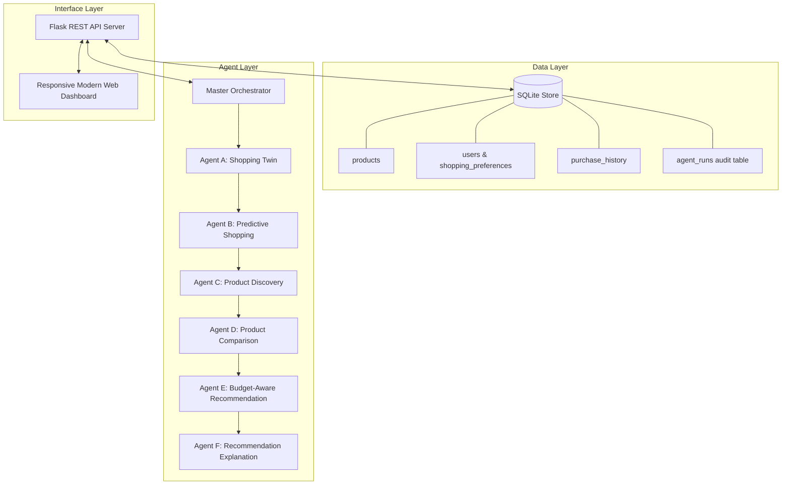

# PreTwinShop AI - System Architecture Documentation

## 1. High-Level Architecture Overview

PreTwinShop AI implements an autonomous multi-agent decision support architecture where individual specialized agents collaborate sequentially to deliver predictive personal shopping recommendations.

## 2. Agent Responsibilities & Algorithms

### Agent A: Shopping Twin Agent (`ShoppingTwinAgent`)
- **Input:** `user_id`, `run_id`
- **Output:** Structured twin profile containing parsed category preferences, brand affinities, shopping frequency, budget limits, active goals, purchase cadence, and derived insights.
- **Completeness Score:** Computes a 0-100 score quantifying profile density based on history volume and explicit preferences.

### Agent B: Predictive Shopping Agent (`PredictiveShoppingAgent`)
- **Input:** Twin profile from Agent A
- **Output:** Ranked list of anticipated shopping needs with confidence ratings and estimated timeframes.
- **Heuristic Scoring Model:**
  - **Rule 1 (Recurring Category):** Triggered when $\text{count} \ge 2$. Confidence score: $\min(0.9, 0.4 + 0.1 \times \text{count})$.
  - **Rule 2 (Time-Based Replenishment):** Triggered when elapsed days since last order $\ge 25$ days for consumable categories. Confidence score: $0.60$.
  - **Rule 3 (Unpurchased Preferred Category):** Explores preferred categories with 0 past purchases. Confidence score: $0.50$.
  - **Rule 4 (Shopping Goal Alignment):** Maps explicit goal targets directly to catalogue categories. Confidence score: $0.70$.

### Agent C: Product Discovery Agent (`ProductDiscoveryAgent`)
- **Input:** Predictions from Agent B, Twin profile from Agent A
- **Output:** Ranked list of matching products discovered in the catalogue.
- **Scoring Formula:**
  $$\text{Relevance} = 0.4 \times \mathbb{I}_{\text{category}} + 0.2 \times \mathbb{I}_{\text{brand}} + 0.2 \times \mathbb{I}_{\text{budget}} + 0.2 \times \mathbb{I}_{\text{keywords}}$$

### Agent D: Product Comparison Agent (`ProductComparisonAgent`)
- **Input:** Discovered candidate products, Twin profile
- **Output:** Feature comparison matrix, advantage & limitation annotations, and winner selection.
- **Winner Heuristic:**
  $$\text{Score} = 0.4 \times (1 - \frac{\text{Price}}{\text{MaxPrice}}) + 0.3 \times \min(\frac{\text{NumSpecs}}{5}, 1.0) + 0.3 \times \mathbb{I}_{\text{preferred\_brand}}$$

### Agent E: Budget-Aware Recommendation Agent (`BudgetAwareRecommendationAgent`)
- **Input:** Discovered products, Comparison matrix, Twin profile
- **Output:** Constructed basket complying with hard budget ceiling, total cost calculation, budget fit status, and cheaper alternative recommendations.
- **Constraint:**
  $$\sum_{i \in \text{Basket}} \text{Price}_i \le \text{Budget}_{\max}$$

### Agent F: Recommendation Explanation Agent (`RecommendationExplanationAgent`)
- **Input:** All previous agent outputs, run_id
- **Output:** Structured natural language justifications linking stated user intent, historical cadence, and pricing factors. Transparently communicates limitations. Optional LLM enhancement with zero-breakage deterministic template fallback.
